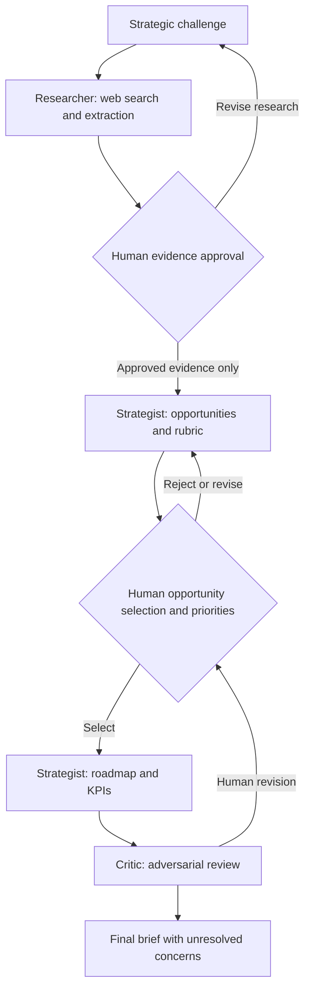
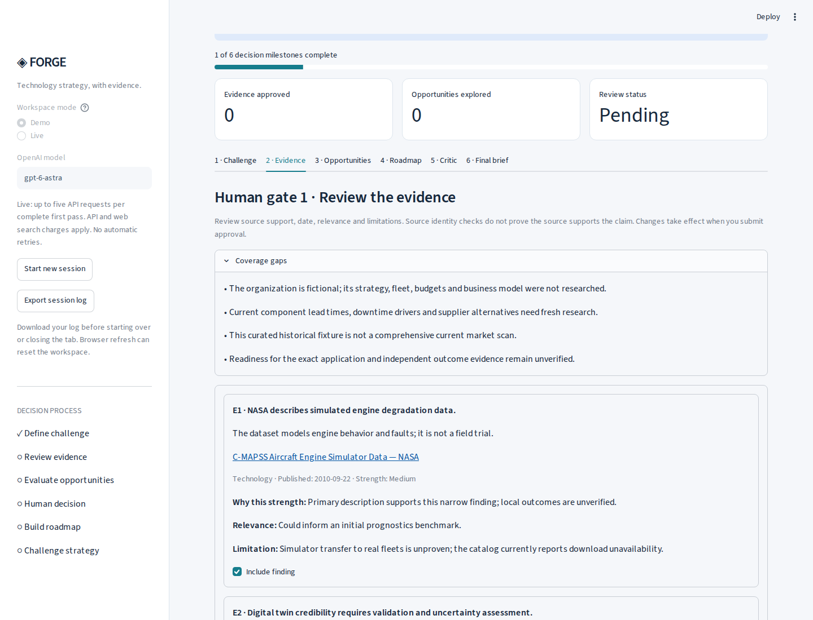
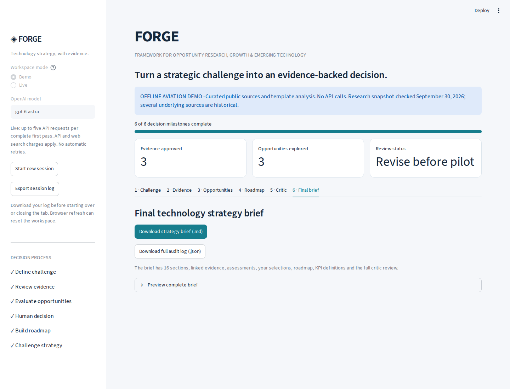

# FORGE

**Framework for Opportunity Research, Growth & Emerging Technology**

A human-controlled technology strategy workbench: research a business problem, inspect evidence, compare opportunities, choose a direction, and challenge the resulting pilot plan.

**Status:** academic/portfolio prototype. The offline demonstration and separate Live API workflows have been exercised; 27 local automated tests passed on November 17, 2026. Tests primarily exercise application logic with mocked API calls rather than proving real-world recommendation quality. Research and generated recommendations must be independently verified.

## Overview

FORGE produces a traceable initial technology strategy brief. Its core product is the decision process: two explicit human approval gates, consistent assessment criteria, linked evidence, and a separate adversarial review. It is industry agnostic in Live mode. Demo mode is a fixed aviation scenario and is always labeled as such.

## Problem

Technology recommendations can sound convincing while hiding weak evidence, uncertain assumptions, implementation barriers and the people affected. Leaders need a way to inspect the basis of a recommendation and decide what deserves a pilot.

## Why I Built It

I wanted a portfolio project that connects business problems, emerging technology and human-centered AI. FORGE is intended to demonstrate how I frame and evaluate a technology decision, including the reasons a promising idea might fail. The MVP and later iterations were implemented with substantial AI coding assistance. I directed requirements, reviewed outputs, reported failures, requested changes, and tested the application. This remains a prototype, not a validated consulting product.

## Quick start

Use Python **3.12** for the tested environment. Unzip this project, open a terminal in the FORGE folder, and run:

```bash
python3 -m venv .venv
source .venv/bin/activate
python -m pip install -r requirements.txt
python -m streamlit run app.py
```

On Windows, activate with `.venv\Scripts\activate` instead. Open the local URL printed by Streamlit. Demo mode needs **no API key**.

Demo walkthrough: Research Opportunity → Evidence stage → optionally exclude E4 → Approve Evidence & Continue → Generate Technology Opportunities → Opportunities stage → add priorities and choose a deep dive → Approve Selection & Build Roadmap → Roadmap stage → Run Independent AI Strategy Review → Critic stage → Continue to final strategy brief → download PDF/Markdown and log.

## How to Add API Key

Copy `.env.example` to `.env` and edit it locally:

```dotenv
OPENAI_API_KEY=your_key_here
OPENAI_MODEL=gpt-6-astra
```

Never paste a key into the challenge or commit `.env`. The model is configurable in the sidebar; your account must support the chosen model, Responses API, web search and structured outputs. Model access and billing are account dependent. API usage is billed separately from the local demo. A first complete live run makes five API requests: search, evidence extraction, opportunities, roadmap and critic. Re-running stages incurs additional usage.

Select **Live** before researching. Live inputs start blank, and obvious retail/aviation contradictions trigger a warning before API use. The user can intentionally override that warning. This heuristic is not a guarantee of input correctness. If a demo is already loaded, export its log and select **Start new session** first. Enter any industry, organization and challenge. Research can take several minutes across the workflow. Requests have a 180-second timeout and no automatic retries.

## System Architecture



Three logical agents, five requests in the live happy path. No agent framework or autonomous external actions. The final report is assembled deterministically from reviewed objects rather than introducing another generative summarizer.

| File | Responsibility |
|---|---|
| `app.py` | Six workspace tabs exposing the nine requested process stages |
| `agents.py` | Responses API calls, citation registry checks, safe errors |
| `prompts.py` | Versioned researcher, strategist and critic instructions |
| `schemas.py` | Pydantic contracts and structured output schemas |
| `workflow.py` | Human gates and invalidation of downstream artifacts |
| `methodology.py` | Ten transparent qualitative evaluation dimensions |
| `logging_utils.py` | Session JSONL, redaction, in-memory export fallback |
| `report.py` | Sixteen-section Markdown brief with linked citations |
| `demo.py` | Explicitly labeled public aviation fixture |
| `tests/` | Workflow, actual SDK mock transport and Streamlit AppTest tests |

## Human-Centered AI Design

- Evidence is visible **before** the first recommendation. Users explicitly approve included findings; rejected evidence is excluded from downstream prompts.
- The user selects which opportunities remain in consideration, chooses the deep dive, and submits priorities.
- Changed evidence clears old opportunities, roadmap and critic output. Changed selections clear the old strategy and review.
- Unsubmitted form edits are drafts. The last submitted approval is the authoritative snapshot.
- Assessments use High/Medium/Low/Unknown with visible anchors and reasons. No overall score or fabricated numerical ROI is produced.
- The critic receives a fresh request. This is role separation, not independent third-party assurance; correlated model errors remain possible.
- Criticism remains in the final brief even when the verdict is “Revise before pilot.” Exporting is not an implementation approval.

## Evidence controls and limitations

Research first obtains web-search citation annotations, then converts the sourced narrative into structured findings. A finding is rejected if its URL is absent from that citation registry. Strategist and critic evidence IDs must belong to the approved set. Required assessment dimensions and roadmap phases are validated.

These controls verify provenance links and structure. They **do not prove factual correctness, entailment, publication dates, completeness, source independence, or defensibility of a rating**. A human must open and inspect sources. Prompts tell models to distinguish assumptions and use Unknown where evidence is insufficient, but semantic compliance needs evaluation. The app does not automatically archive full source pages or check every claim against them.

## Technology Stack

Python, Streamlit, OpenAI Python SDK / Responses API, built-in web search, Pydantic, JSONL and Markdown. JSON session logs avoid unnecessary database infrastructure. Runtime dependencies are in `requirements.txt`; optional tests and screenshots use `requirements-dev.txt`.

## Example Use Case

A fictional commercial aviation company wants to reduce maintenance downtime and component disruptions over 3–10 years. The curated case uses public NASA, NIST, Airbus and GE material. It contains no confidential interviews or company data.

The demo supports four predetermined example options. Excluding E4 removes the additive-manufacturing option. At least three demo findings are needed to retain three supported options. Live mode discovers opportunities from research rather than using these templates. Demo comments are preserved as a validation agenda item; semantic rewriting from comments occurs only in Live mode.

## Screenshots





A short silent recording of the actual browser workflow is included at `sample_outputs/FORGE_silent_demo.mp4`. Use the narrated script for the longer academic presentation.

See `screenshots/` and [project report](docs/PROJECT_REPORT.md). The capture script records the actual local app; it does not create mock screenshots. Capture on your machine if browser installation is unavailable:

```bash
python -m pip install -r requirements-dev.txt
python -m playwright install chromium
python scripts/capture_demo.py
```

## Logging and submission evidence

Every application API attempt logs the timestamp, session ID, agent, model, developer instructions, actual prompt, input, schema and settings. Responses include output, returned source annotations and usage when available. Failures log their error class without exposing credential-bearing exception strings. Raw malformed model responses are logged before validation. Approval/rejection events and feedback are recorded. Keys and common credential fields are redacted.

Logs are private local `logs/<uuid>.jsonl` files (ignored by Git). Downloads contain the current browser session's events. They are not tamper-proof records. Logs may contain sensitive business text, so review before sharing. Disk write failures retain an in-memory export and show a warning. Restart/refresh may lose in-memory state. Export before leaving; this version does not restore sessions from disk.

**Development and runtime records are different:** the app cannot retroactively capture this ChatGPT build conversation. `docs/BUILD_REQUEST.txt` preserves the supplied brief and `docs/DEVELOPMENT_LOG.md` summarizes the build. Export the original ChatGPT conversation separately if your professor requires every development prompt and response. `sample_outputs/demo_session.json` is an actual deterministic demo execution log, not fabricated API activity.

## Deployment

The app follows the standard Streamlit entry-point/dependency structure. See [deployment instructions](docs/DEPLOYMENT.md) for a GitHub-to-Community-Cloud checklist. No public deployment, external repository creation, or hosted URL is claimed by this package. A public deployment with your server API key lets visitors consume your quota; keep the portfolio demo keyless or use host-level access controls for live research.

## Tests

```bash
python -m pip install -r requirements-dev.txt
python -m pytest -q
```

See `docs/TESTING.md` for observed results and untested boundaries. Tests use no paid API calls. SDK transport tests validate serialized request bodies and parse mock HTTP responses using the installed OpenAI client.

## Limitations

- No paid live run was possible here; add a key and run the documented smoke test before presenting live AI results.
- Historical curated demo evidence is intentionally modest and does not establish current fleet outcomes or a competitive advantage.
- The tool does not determine legal compliance or authorize maintenance, procurement or flight release.
- No authentication, cloud log durability, saved-session restore, PDF exporter, operational connectors or production monitoring.
- A 3–5-option requirement may encourage weak options when approved evidence is sparse. Treat those as research hypotheses; reject them when needed.
- Numerical maturity levels and empirical confidence calibration are not implemented. Maturity labels and ordinal assessments remain judgments.
- No measured stakeholder benefit, ROI, accuracy benchmark or user study has been completed.

## Responsible AI Considerations

Use public information for the portfolio demonstration. Preserve uncertainty and provenance, inspect adversarial findings, involve affected users, and evaluate the workflow against a process-only alternative. Use data minimization and purpose limits. Never equate an AI-generated roadmap with engineering validation or safety approval.

## Skills Demonstrated

Problem framing; technology strategy; constrained agentic workflow design; evidence review; prompt engineering; qualitative opportunity evaluation; human control and traceability; pilot/KPI design; product design; API integration; and testable responsible-AI controls. The current artifact demonstrates those design choices, not proven business impact.

## Future Improvements — ranked by value

1. Run live evaluations on several industries with an expert-labeled claim/source support set.
2. Test with strategy users; measure evidence-review quality, usability and decision usefulness.
3. Add claim-level source excerpts, contradictions and stale-source detection.
4. Add durable session restore, budget limits and host-level access controls for shared use.
5. Add model/provider diversity for critique and compare it with human expert review.
6. Add PDF exports and presentation polish after reliability is established.

## Graduate and portfolio package

- [Project report](docs/PROJECT_REPORT.md)
- [Portfolio case study and résumé bullets](docs/PORTFOLIO_CASE_STUDY.md)
- [5–7 minute video script](docs/VIDEO_DEMO_SCRIPT.md)
- [Nine-slide outline](docs/PRESENTATION_OUTLINE.md)
- [Five journal references and their scope](docs/ACADEMIC_REFERENCES.md)
- [Methodology](docs/METHODOLOGY.md)
- [Development provenance](docs/DEVELOPMENT_LOG.md)

FORGE is the demonstrator. For a G-Tech submission focused on technology 5–10+ years ahead, pair it with a specific emerging research question rather than presenting a Streamlit app or today's API orchestration as a future invention. The project report proposes such a framing and labels the horizon assumptions.


## Responsible use and limitations

FORGE uses generative AI for research synthesis and strategy planning. Sources, ratings, and recommendations may be incomplete or wrong. Demo mode uses prewritten aviation examples and makes no API calls. Live mode can incur API charges; the cost indicator is an estimate, not a hard spending cap. Do not enter sensitive client data without appropriate data governance. Human review is required for consequential decisions.

## Testing

Install development dependencies with `python -m pip install -r requirements-dev.txt`, then run `python -m pytest -q`. The project owner reported **27 passed** on November 17, 2026. That is test-suite evidence, not proof of production readiness.
